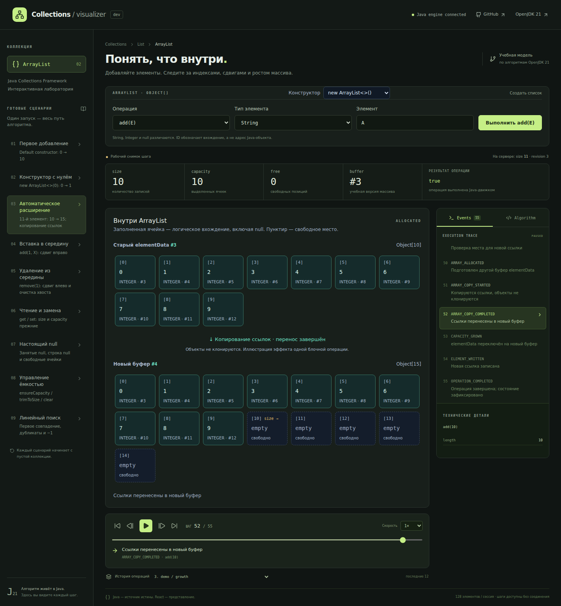

# Java Collections Visualizer

Интерактивная лаборатория Java HashMap и ArrayList: выполняйте операции и наблюдайте
цепочки, деревья, внутренние массивы, сдвиги и расширение буферов.

**[Открыть приложение](https://java-collections-vizualizer.pages.dev)** ·
[Контракт API](docs/API.md) ·
[Архитектура](docs/ARCHITECTURE.md)

Это **учебная инструментированная реализация, ориентированная на OpenJDK 21**.
Она исполняет алгоритм на Java и создаёт события непосредственно в ходе выполнения.
Приватные объекты `java.util.HashMap` / `java.util.ArrayList` в JVM не наблюдаются и через рефлексию не читаются.


## Возможности

- ArrayList: `add`, `add(index)`, `get`, `set`, `remove(index)`, `indexOf`, `clear`, `reset`, `ensureCapacity`, `trimToSize`; String, Integer, null и девять сценариев.
- Переключение коллекций создаёт пустую структуру в том же изолированном слоте сессии. Для ArrayList доступен выбор конструктора: default, explicit-zero и положительная ёмкость.
- Операции HashMap `put`, `get`, `remove`, `clear`, `reset`; String, Integer, null и учебные ключи с заданным hashCode.
- Коллизии, resize/split, treeification и балансировка красно-чёрного дерева; восемь готовых сценариев.
- Пошаговое воспроизведение, перемотка, скорость и история последних 12 операций.
- SVG-диаграмма с масштабированием и мобильным интерфейсом.
- Изолированные сессии с TTL, revision и ограничениями нагрузки.



## Технологии и архитектура

| Каталог | Назначение |
|---|---|
| `core/` | Java 21: инструментированные HashMap / ArrayList, события и неизменяемые снимки |
| `backend/` | Spring Boot: REST API, сессии, compact trace и ограничения запросов |
| `frontend/` | React, TypeScript, Vite, Tailwind CSS, Motion и SVG |
| `scripts/` | Git-версионирование, упаковка артефактов и локальные измерения |

Java исполняет алгоритм и формирует trace; React размещает узлы и воспроизводит
готовые снимки. Перемотка не вызывает API и не меняет состояние коллекции.

## Быстрый запуск

Нужны **JDK 21**, **Node.js 22.12+ из ветки 22 или Node.js 24+**, npm,
Git и POSIX shell (`sh`). Maven Wrapper сам скачает Maven 3.9.11;
отдельно устанавливать Maven не нужно. Первый запуск требует сети для зависимостей.
Windows: используйте WSL или Git Bash; для `mvnw.cmd` также нужен `sh` в PATH.
JDK выбирается через `JAVA_HOME` либо `java` в PATH.

Клонируйте репозиторий и установите зависимости из его корня:

```bash
git clone https://github.com/Oleg520/java-collections-vizualizer.git
cd java-collections-vizualizer
./mvnw -B clean install -DskipTests
npm --prefix frontend ci
```

Maven собирает оба модуля и устанавливает родительский POM и `core` в локальный
Maven repository: они нужны для отдельного запуска `backend`.
Все зависимости доступны публично. Настройки, секреты и дополнительные
Spring-профили для локального запуска не нужны: используются defaults приложения.

В первом терминале из корня проекта:

```bash
./mvnw -pl backend spring-boot:run
```

Во втором терминале из корня проекта:

```bash
npm --prefix frontend run dev
```

Откройте **http://127.0.0.1:5173**. Vite проксирует `/api` на `http://127.0.0.1:8080`.
Проверка backend: `curl --fail http://127.0.0.1:8080/api/v1/health`.
Остановить каждый процесс можно через Ctrl+C. Изменения frontend подхватывает Vite.
После изменений Java остановите backend, пересоберите оба модуля и запустите его снова:

```bash
./mvnw -B clean install -DskipTests
./mvnw -pl backend spring-boot:run
```

Повторный `install` обновляет в том числе изменённый `core`.
Не добавляйте `-am` к `spring-boot:run`: Maven попытается запустить также
родительский модуль и `core`, в которых нет Spring Boot main-класса.

Сборка использует Git checkout и точные теги; ZIP исходников не подходит.
После смены коммита или тегов повторите `clean install`: Git определяет версии
всех модулей, поэтому зависимости предыдущего коммита не подходят.
Если порт занят, остановите прежний процесс. Параметры API описаны в
[API security](docs/API_SECURITY.md), локальная диагностика — в
[Observability](docs/OBSERVABILITY.md).

## Проверка

```bash
./mvnw verify
npm --prefix frontend run build
npm --prefix frontend test
python3 -m unittest discover -s scripts/tests -v
```

Команды выполняются из корня после установки зависимостей.
`verify` запускает Java-тесты и собирает исполняемый backend JAR.
Python 3 нужен только для проверок Git-версий и упаковки.
Для E2E установите Chromium:

```bash
npm --prefix frontend exec -- playwright install --only-shell chromium
npm --prefix frontend run test:e2e
npm --prefix frontend run test:e2e:lifecycle
```

Playwright запускает собранный JAR и Vite сам; после изменений Java сначала
повторите `./mvnw clean verify`. Перед lifecycle-прогоном освободите порты
8080/5173. [Полная проверка, E2E и измерение ресурсов](docs/TESTING.md).

## Отдельный статический hosting

Для отдельного статического hosting задайте `VITE_API_URL` до сборки frontend
и точные `ALLOWED_ORIGINS` у backend. Локально оставьте
[frontend/.env.example](frontend/.env.example) без изменений; копировать его
не требуется. [Настройки preview и релизных артефактов](docs/RELEASE_ARTIFACTS.md).

## Ограничения

HashMap: до 128 записей и 512 учебных ID на сессию, load factor 0.75.
ArrayList: до 128 элементов, 256 выделенных ячеек, значение до 128 UTF-16 code units.
Это учебные лимиты. Стратегия роста — деталь OpenJDK 21, не гарантия Java API.
Сессии хранятся в памяти одного backend и теряются при перезапуске.
Авторизации, БД и постоянной истории нет. Это учебная модель, а не отладчик JVM.

## Документация

- [Архитектура, сценарии и тонкости OpenJDK](docs/ARCHITECTURE.md)
- [Контракт API](docs/API.md) и [OpenAPI](docs/openapi.yml)
- [Ограничения API и доверие proxy](docs/API_SECURITY.md)
- [Проверки](docs/TESTING.md) и [результаты измерений](docs/verification/README.md)
- [Надёжность](docs/RELIABILITY.md) и [направление развития архитектуры](docs/ARCHITECTURE_VISION.md)
- [Версионирование](docs/VERSIONING.md) и [контракт артефактов](docs/RELEASE_ARTIFACTS.md)
- [Участие в разработке](CONTRIBUTING.md)
- [Мобильный интерфейс](docs/hashmap-mobile.png)

## Исходник и лицензия

Алгоритмы адаптированы из [OpenJDK 21 HashMap.java](https://github.com/openjdk/jdk21u/blob/3f3a1f534b7f2f5be6d7ded9d9832fa9394e763c/src/java.base/share/classes/java/util/HashMap.java).
ArrayList адаптирован из тега [jdk-21.0.5+11](https://github.com/openjdk/jdk21u/blob/jdk-21.0.5%2B11/src/java.base/share/classes/java/util/ArrayList.java).
Исходные copyright/license headers сохранены. Проект GPL-2.0; участки OpenJDK
сохраняют Classpath exception. Подробности, перечень изменений и checksum исходника:
[THIRD_PARTY_NOTICES.md](THIRD_PARTY_NOTICES.md), [LICENSE](LICENSE).
