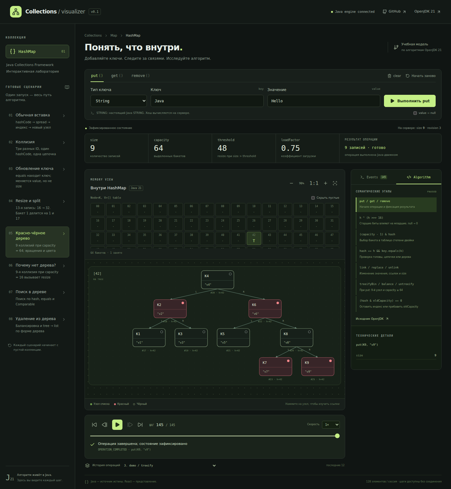

# Java Collections Visualizer

Интерактивная лаборатория внутреннего устройства Java HashMap: вводите ключи,
выполняйте операции и наблюдайте вычисления, цепочки, resize и красно-чёрное дерево.

Это **учебная инструментированная реализация, ориентированная на OpenJDK 21**.
Она исполняет алгоритм на Java и создаёт события непосредственно в ходе выполнения.
Приватные объекты `java.util.HashMap` в JVM не наблюдаются и через рефлексию не читаются.



[Мобильный интерфейс](docs/hashmap-mobile.png) · [Контракт API](docs/API.md) ·
[OpenAPI](docs/openapi.yml) · [Отчёт о реализации](docs/IMPLEMENTATION_REPORT.md)

## Возможности

- `put`, `get`, `remove`, `clear`, `reset`; String, Integer, учебные ключи с заданным hashCode, null-ключи и null-значения.
- Ленивое выделение таблицы; spread `h ^ (h >>> 16)`; индекс `(capacity - 1) & hash`;
  сравнения, цепочки, обновления без увеличения размера.
- Рост по loadFactor 0.75 и split `hash & oldCapacity`, с сохранением порядка половин.
- Treeification с точной семантикой putVal: **9-я** коллизия при capacity ≥ 64;
  при меньшей ёмкости — resize. Настоящие red-black insertion/deletion, вращения,
  перекрашивания, поиск по Comparable, обратное преобразование по правилам JDK.
- Полные неизменяемые снимки, стабильные ID, шаги назад/вперёд, play/pause, restart,
  скорость 0.5–4×, переход к событию, история последних 12 операций.
- Анимированные SVG-узлы и ссылки; дерево, масштаб, прокрутка, скрытие пустых бакетов,
  просмотр parent/left/right/next. Рабочий снимок явно отделён от состояния сервера.
- Шесть обязательных Java-сценариев и два дополнительных: поиск/удаление из дерева.
- Изолированные in-memory-сессии, TTL, лимиты, атомарная проверка revision, CORS.

## Быстрый запуск

Нужны **JDK 21** (`java` в PATH либо `JAVA_HOME`), **Node.js 22.12+** и npm.
Maven 3.9.11 скачивается Maven Wrapper; отдельно устанавливать Maven не нужно.
Первый запуск сборки требует сети для загрузки зависимостей.

```bash
./mvnw verify
npm --prefix frontend ci
npm --prefix frontend run build
```

В первом терминале:

```bash
java -jar backend/target/backend-0.1.0.jar
```

Во втором:

```bash
npm --prefix frontend run dev
```

Откройте **http://127.0.0.1:5173**. Vite проксирует `/api` на `http://127.0.0.1:8080`.
Проверка backend: `curl http://127.0.0.1:8080/api/v1/health`.
Windows: используйте `mvnw.cmd` вместо `./mvnw`. Альтернативно доступны
`make build`, `make backend`, `make frontend`, `make test`, `make e2e`.

Для разработки backend с Spring Boot:

```bash
./mvnw install -DskipTests
./mvnw -pl backend spring-boot:run
```

## Проверка

```bash
./mvnw verify                         # core + API + исполняемый JAR
npm --prefix frontend test            # Vitest: renderer layout
npm --prefix frontend run build       # strict TypeScript + Vite production
cd frontend
npx playwright install --with-deps chromium
npm run test:e2e                       # backend и Vite запускаются автоматически
E2E_PREVIEW=1 npm run test:e2e          # тот же E2E против production dist, порт 4173
```

Playwright также может использовать уже запущенные серверы на 8080/5173;
для CI требуется свободная пара 8080/4173 (production preview).
`--with-deps` устанавливает системные
библиотеки Chromium и на Linux может требовать административных прав.
Тесты работают с настоящим Java API, без подмены ответов.

Покрыты детерминированные случаи и 2400 псевдослучайных операций против
`java.util.HashMap` на Java 21. После каждой проверяются уникальность ключей/ID,
индексы, цепочки, parent/left/right/prev, чёрный корень, отсутствие красного
родителя у красного узла и одинаковая чёрная высота. Отдельно проверяются
переходы list/tree, split на две половины, видимость узлов в рабочих снимках,
стабильность ID, сохранность предыдущих снимков и результат trace.

GitHub Actions: Java/TS-сборка, unit/API-тесты, Chromium desktop/mobile E2E.
Все восемь сценариев проверяются при initialCapacity 0/16/32/64. E2E также
проверяет большой split на 97-й вставке, конфликт revision и offline-воспроизведение.
Обычный прогон не меняет скриншоты документации; для их обновления:
`UPDATE_SCREENSHOTS=1 npm run test:e2e` (из frontend).

Измерение ресурсов на отдельном локальном тестовом backend (создаёт 19 сессий,
исполняет большие split и два пакета параллельных сценариев):

```bash
java -Xms64m -Xmx256m -jar backend/target/backend-0.1.0.jar
# В другом терминале; Python 3, без дополнительных пакетов:
python3 scripts/profile.py --pid JAVA_PID --jcmd "$JAVA_HOME/bin/jcmd"
```

`--pid` и `--jcmd` необязательны; для RSS и retained heap нужны Linux / локальный
JDK. Проба вызывает GC только при явном указании jcmd. `--encoding full` позволяет
сравнить старый формат. Вывод: `docs/verification/resource-profile.json`.
Результаты и границы измерений приведены в отчёте о реализации.

## Архитектура

```text
core/       Java 21, без Spring и JSON-зависимостей
  InstrumentedHashMap   алгоритмы OpenJDK + семантические точки наблюдения
  HashMapEngine         команды, ключи, снимки, trace, сценарии
  CollectionEngine<S>   граница для следующей коллекции
  Protocol              неизменяемые транспортные records
backend/    Spring Boot 3.5.16, REST, сессии, optimistic revision, TTL, CORS
  CompactTrace          обратимое кодирование: общая таблица версий узлов
frontend/   React 19 + TypeScript + Vite 7 + Tailwind CSS 4 + Motion + SVG
  api.ts / types.ts     HTTP и контракт
  trace.ts              разрешение ссылок компактного trace без повторения алгоритма
  App.tsx               операции, история, независимое воспроизведение
  layout.ts             только размещение по ссылкам из Java
  Diagram.tsx           SVG и прерываемые анимации по стабильным ID
```

`CollectionEngine<S>` и `Trace<S>` не зависят от HashMap-схемы. Для новой коллекции
нужны отдельная модель состояния и renderer; инфраструктуру команд, сессий и
воспроизведения можно переиспользовать. Другие коллекции в MVP не реализованы.

Каждый запрос завершается на Java до воспроизведения. Перемотка выбирает готовый
snapshot. Следующая команда исполняется над **последним состоянием сервера**, даже
если пользователь смотрит ранний шаг или старую операцию. Во время запроса новые
команды отключены, но навигация по истории доступна. При потере ответа клиент
не повторяет мутацию, а запрашивает актуальное состояние.

## Сценарии и тонкости JDK

| Сценарий | Реальные входные данные |
|---|---|
| Вставка | String `Java` → `Hello` |
| Коллизия | TeachingKey A/B/C, hashCode 42 |
| Обновление | `language`: `Java 17` → `Java 21` |
| Resize | `stay:1`, `move:17`, ещё 11 ключей: capacity 16 → 32; бакет 1 делится на 1/17 |
| Treeification | Конструктор с ёмкостью 64, девять ID K1…K9 с hashCode 42 |
| Почему нет дерева | Стандартный конструктор, девять тех же коллизий: capacity 16 → 32 |
| Поиск в дереве | После treeification — get(K7) |
| Удаление из дерева | После treeification — remove(K1)…remove(K8) |

`TREEIFY_THRESHOLD=8` — проверка счётчика при добавлении в уже существующую
цепочку, а не безусловное дерево на восьмой вставке. `UNTREEIFY_THRESHOLD=6`
применяется к половинам **split при resize**. Для обычного удаления JDK использует
проверку **формы** дерева (`root.right`, `root.left`, `root.left.left`), поэтому
универсального правила «удалили до шести — получили список» здесь нет.

`clear` сохраняет массив и закреплённые hashCode учебных ID; `reset` освобождает
таблицу и начинает новую коллекцию с параметрами, заданными при создании сессии.
Каждый сценарий задаёт свой конструктор и отражает это событием CONFIGURED:
64 для трёх сценариев дерева, стандартный конструктор для остальных.
Сценарии не наследуют initialCapacity сессии и не меняют её настройку RESET.
В режиме без выделенной таблицы threshold у конструктора с ёмкостью
содержит целевую ёмкость, а не обычный порог загрузки.

## Раздельный деплой

Backend опубликован на Selectel VDS:
[проверка HTTPS API](https://jcv-api.135-106-208-51.sslip.io/api/v1/health).
Он работает отдельным systemd-сервисом, слушает только localhost и доступен через
Caddy. Конфигурация, ограничения ресурсов и обновление/откат описаны в
[инструкции развёртывания](deploy/README.md).

Frontend подготовлен для Netlify: корневой `netlify.toml`, сборка из `frontend/`,
публикация `frontend/dist`. До сборки задайте **VITE_API_URL** — публичный HTTPS
origin отдельно размещённого Java backend, **без `/api/v1`**. Пример:
`VITE_API_URL=https://your-java-service.example`. Переменная встраивается Vite
при сборке. Для локального режима оставьте её пустой; пример — `frontend/.env.example`.
Без настроенного внешнего API статический сайт сам по себе операции не исполнит.

Backend запускается JAR-файлом или контейнером:

```bash
docker build -t collections-viz .
docker run --rm -p 8080:8080 \
  -e ALLOWED_ORIGINS=https://your-site.netlify.app \
  -e MAX_SESSIONS=64 collections-viz
# Локальный backend через Compose:
docker compose up --build
```

| Переменная backend | По умолчанию | Назначение |
|---|---|---|
| `PORT` | 8080 | HTTP порт |
| `ALLOWED_ORIGINS` | localhost/127.0.0.1:5173, :4173 | Точные origin через запятую, без завершающего `/` |
| `SESSION_TTL_SECONDS` | 1800 | Время без обращений |
| `MAX_SESSIONS` | 128 | Лимит активных сессий |
| `HTTP_THREADS` | 8 | Ограничение параллельной работы Tomcat (не менее 2) |
| `JAVA_TOOL_OPTIONS` | в Docker: MaxRAMPercentage=70 | Настройки JVM |

Статический frontend не требует сервера Node в production. JVM нужен провайдер,
способный запускать долгоживущий Java-процесс/контейнер; Netlify используется для
frontend. Конфигурация backend не привязана к провайдеру. Для небольшой демоверсии
достаточно начать с одного процесса с бюджетом 512 MiB и измерить расход под своей
нагрузкой. Условия бесплатных тарифов здесь не обещаются. Учтены холодные запуски:
60-секундный HTTP timeout и видимое сообщение ожидания. Health endpoint — `/api/v1/health`.

При нескольких экземплярах нужны sticky sessions либо общее хранилище;
в текущем MVP используется один процесс. Перезапуск сервиса теряет сессии.
Production-конфигурация Netlify уже содержит VITE_API_URL для опубликованного API.
Для завершения подключения frontend нужны авторизация Netlify и точный origin
проекта в ALLOWED_ORIGINS; конфигурация остаётся независимой от провайдера.

## Границы MVP

- Только HashMap; максимум 128 записей, 512 учебных ID на сессию. Значения — String/null.
- Load factor фиксирован 0.75; начальная ёмкость через API: 0 (default), 16, 32 или 64.
- Все шаги trace передаются целиком. Frontend использует компактную таблицу версий
  узлов; исходный полный формат API сохранён. Локальная история хранит 12 последних операций,
  не переживает обновление вкладки. Долгое воспроизведение не продлевает серверный TTL.
- Промежуточные WORKING-снимки могут временно нарушать итоговые инварианты, как реальный
  алгоритм. Ряд перекрашиваний объединён со снимком вращения или завершения балансировки;
  отдельное событие на каждое присваивание цвета не обещается.
- Algorithm — схема семантических этапов; это не построчная отладка исходника JVM.
- Авторизация, БД, распределённые сессии, внешние rate limits и другие коллекции не добавлены.

## Исходник и лицензия

Алгоритмы адаптированы из [OpenJDK 21 HashMap.java](https://github.com/openjdk/jdk21u/blob/3f3a1f534b7f2f5be6d7ded9d9832fa9394e763c/src/java.base/share/classes/java/util/HashMap.java).
Исходные copyright/license headers сохранены. Проект GPL-2.0; участки OpenJDK
сохраняют Classpath exception. Подробности, перечень изменений и checksum исходника:
[THIRD_PARTY_NOTICES.md](THIRD_PARTY_NOTICES.md), [LICENSE](LICENSE).
